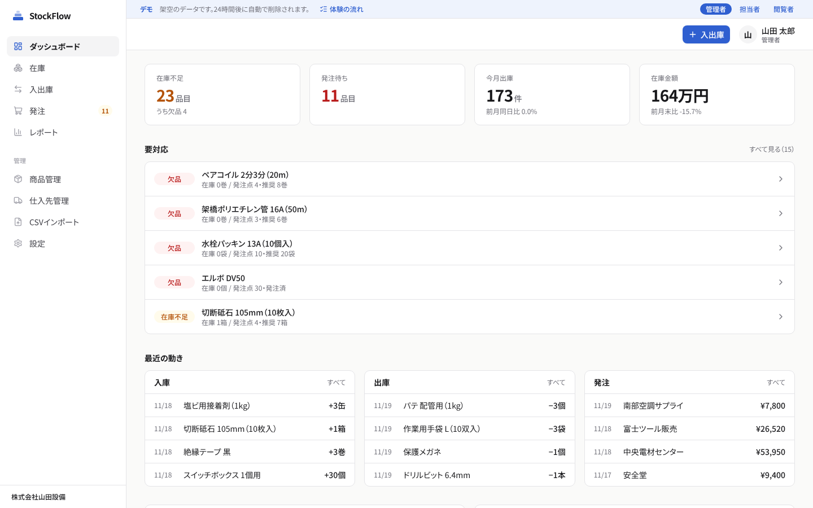
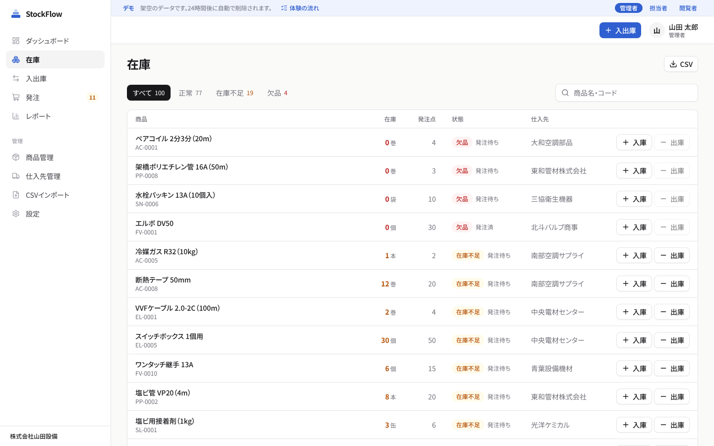
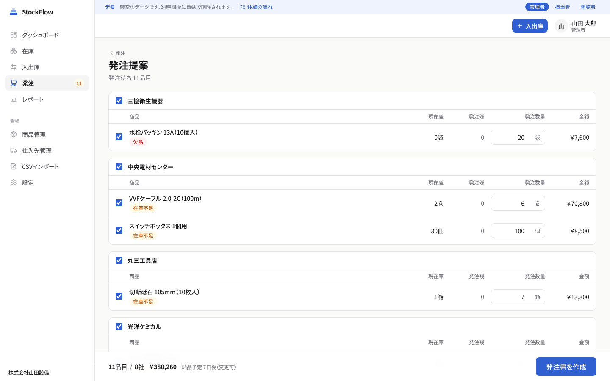
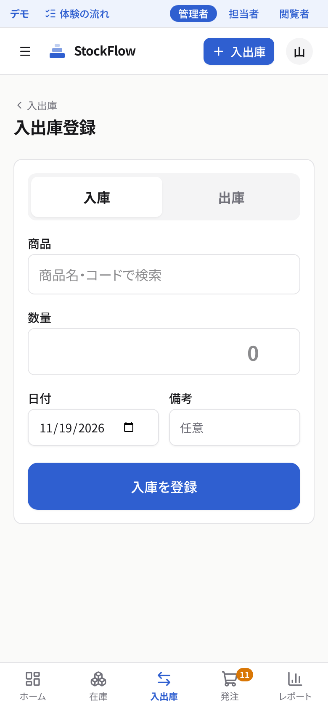

# StockFlow — 在庫・発注管理

中小企業向けの在庫・発注管理 Web システムです。入出庫の記録から在庫を計算し、発注が必要な商品と発注数を提案、仕入先別の発注書（PDF）作成から入荷までを1つの画面で行えます。

> ポートフォリオ作品です。デモに出てくる会社（株式会社山田設備）・商品・数値はすべて架空です。



| 在庫一覧 | 発注提案 | スマホで入出庫 |
| --- | --- | --- |
|  |  |  |

## できること

| 画面 | 内容 |
| --- | --- |
| ダッシュボード | 在庫不足・発注待ち・今月の出庫件数・在庫金額（参考値）、要対応（欠品 → 在庫不足 → 発注待ち → 入荷遅延の順に5件）、最近の動き、グラフ2つ |
| 在庫 | 検索・絞り込み（すべて／正常／在庫不足／欠品）、行から入庫・出庫。商品詳細は「在庫推移／入出庫／発注／商品情報」のタブ |
| 入出庫 | 入庫・出庫の登録（スマホで片手入力）、履歴、棚卸の調整、取消（逆の記録を追加） |
| 発注 | 発注提案（推奨数を計算）→ 仕入先ごとに発注書を自動で分割 → PDF → 発注済 → 入荷（分納可） |
| レポート | 在庫金額推移・月別入出庫・発注金額推移・在庫不足件数推移・出庫ランキング・カテゴリ別在庫金額・長期滞留在庫 |
| 商品・仕入先 | マスタの登録・編集（使わなくなったら無効にする。履歴が残るので削除しない） |
| CSV | 取込：商品マスタ・初期在庫・入出庫履歴（ファイル → プレビュー → 項目の割り当て → 確認 → 登録）。出力：商品・在庫・入出庫・発注 |
| 設定 | 会社情報（発注書に印字）・滞留の日数・既定のリードタイム・カテゴリ・メンバーと役割 |

### 在庫と発注のルール

- 在庫は入出庫の記録（`stock_movements`）の合計です。記録は書き換え・削除せず、訂正は「取消（逆の記録）」や「棚卸の調整」を追加します。
- 在庫を超える出庫はできません（「在庫が不足しています（残り8個）」）。判定はサーバーの DB 関数がトランザクションの中で、在庫の行をロックして行います（同時に出庫してもマイナスにならない）。
- 状態：在庫 0 以下＝欠品、発注点以下＝在庫不足、それ以外＝正常。
- 推奨発注数 ＝ MAX(0, 目標在庫 − 現在庫 − 未入荷の発注残) を最低発注数量まで増やし、発注単位の倍数に切り上げ。
- 登録・発注・入荷は冪等性キー付きで、二度押しや通信の再試行で二重に登録されません。発注数を超える入荷はできません。
- 単位の違う数量は合計しません（集計は件数か、仕入単価で計算した金額＝参考値）。

### 役割

| | 管理者 | 担当者 | 閲覧者 |
| --- | :-: | :-: | :-: |
| 閲覧・CSV出力 | ○ | ○ | ○ |
| 入出庫・発注・入荷 | ○ | ○ | − |
| 棚卸の調整・取消 | ○ | − | − |
| 商品・仕入先・設定・CSV取込 | ○ | − | − |

画面（メニュー・ボタン）・サーバー（Server Actions）・データベース（RLS と DB 関数）の3か所で確かめています。会社ごとのデータは行レベルセキュリティ（RLS）で分離しています。

## デモ

- 紹介ページの「デモを試す」、またはログイン画面で役割（管理者・担当者・閲覧者）を選ぶと、**あなた専用の**デモ会社が作られます（24時間後に自動で削除）。他の人の操作の影響を受けません。
- 約100品目・仕入先15社・半年分の入出庫と発注の履歴があり、欠品・在庫不足・発注待ち・一部入荷・入荷遅延・長期滞留・よく出る商品がそろっています。
- 3〜5分の流れ：ダッシュボードの「要対応」で不足に気づく → 発注提案（例：塩ビ管 VP20 は在庫8・目標30で推奨22本）→ 発注書を作成 → PDF → 発注済にする → 入荷を登録 → 在庫が増え、状態が正常に戻る。画面上部の「体験の流れ」からも辿れます。

## 技術構成

| | |
| --- | --- |
| 画面・サーバー | Next.js 16（App Router・Server Actions）、React 19、TypeScript、Tailwind CSS 4、Radix UI、Recharts、react-hook-form＋zod |
| データベース | PostgreSQL（Neon。Supabase でも可）。postgres.js で接続し、トランザクションごとに `authenticated` ロールと利用者の情報を設定して RLS を効かせる |
| 業務ロジック | 在庫・発注・入荷・取込の書き込みは `security definer` の DB 関数だけ（利用者は表に直接書き込めない） |
| PDF | pdf-lib＋IPAゴシック（A4・日本語）。Supabase Storage への保存にも対応（任意） |
| テスト | Vitest（単体・DB）、Playwright（PC・スマホの E2E） |
| 公開 | Vercel（sin1）＋ Neon（シンガポール） |

設計の詳細は [docs/DESIGN.md](docs/DESIGN.md) を参照してください。

## ローカルで動かす

必要なもの：Node.js 22、PostgreSQL 16（`postgres` / `postgres` で接続できること）

```bash
npm ci
cp .env.example .env.local          # 中身はそのままで動きます
npm run db:local:reset              # DB「stockflow」を作り直してマイグレーションを適用
npm run db:seed                     # 見本の会社を投入
npm run dev                         # http://localhost:3000
```

- 「デモを試す」でそのまま使えます。
- 見本の会社には `admin@stockflow.example` / `staff@stockflow.example` / `viewer@stockflow.example`、パスワード `stockflow-demo-2026`（ローカル専用。公開環境では使えません）でもログインできます。

## テスト

```bash
npm run typecheck && npm run lint
npm run test:unit      # 単体（推奨数・状態・CSV・入力検証・日付・デモデータ）
npm run test:db        # DB（入出庫・同時出庫・冪等性・調整・取消・発注・分納・過剰入荷・CSV再取込・RLS・会社の分離・権限）
npm run test:e2e       # ブラウザ（デモの一連の流れ・在庫不足の出庫・二度押し・権限・CSV取込・スマホ）
```

DB テストと E2E はローカルの PostgreSQL を使います（`npm run db:local:reset && npm run db:seed` の後に実行）。GitHub Actions（`.github/workflows/ci.yml`）でも同じものを実行します。

## 公開（Vercel ＋ Neon）

GitHub Pages では動きません（サーバーと DB が必要です）。データベースは Vercel の画面からつなげる Neon（PostgreSQL）を使います。Supabase の PostgreSQL でも同じように動きます（下の「Supabase を使う場合」）。

1. [Vercel](https://vercel.com/new) でこのリポジトリをインポート（Framework は Next.js のまま）。
2. **Environment Variables** に2つ登録して **Deploy**。
   | 名前 | 値 |
   | --- | --- |
   | `SEED_LOGIN_PASSWORD` | 見本の会社のログイン用パスワード（12文字以上・自分で決める） |
   | `CRON_SECRET` | 16文字以上のランダムな文字列（毎日の定期処理用） |
3. 初回のビルドは `DATABASE_URL` が無いので失敗します（想定どおり）。
4. プロジェクトの **Storage → Create Database → Neon** を選ぶ。Region は **Singapore**、プランは Free。**Connect Project** で Production と Preview にチェックし、Custom Prefix は空のまま。`DATABASE_URL` と `DATABASE_URL_UNPOOLED` が自動で入ります。
5. **Deployments** で最新のものを **Redeploy**。本番のビルドでだけ、マイグレーション → 見本の会社の作成 が自動で行われます（`scripts/deploy/vercel-build.ts`）。プレビューのビルドでは DB を変更しません。テーブルや関数を手で作る必要はありません。
6. 毎日 3:00（日本時間）に、期限切れのデモの削除と見本の会社の作り直しが行われます（`vercel.json` の Cron）。

Vercel の関数は Neon と同じシンガポール（`sin1`）で動かします（Neon には東京リージョンが無いため、DB の近くに置いています）。

公開後は GitHub Actions の **Production E2E**（`production-e2e.yml`、入力に公開 URL）で、公開環境に対して E2E を実行できます。

### Supabase を使う場合

- `DATABASE_URL` に Supabase の **Transaction pooler**（ポート 6543）、`DATABASE_URL_UNPOOLED` に **Session pooler**（ポート 5432）の接続文字列を登録します。`vercel.json` の `regions` は `hnd1`（東京）に変えてください。
- 発注書 PDF を Supabase Storage にも保存したい場合だけ、`SUPABASE_URL` と `SUPABASE_SERVICE_ROLE_KEY`（強い権限を持つ秘密の値。`NEXT_PUBLIC_` を付けない）を登録します。登録しなくても PDF はダウンロードできます。

## 仕様からの変更点

- **ログインは Supabase Auth ではなく、アプリ内のログイン**（`app_auth` スキーマ、scrypt でハッシュ化したパスワードと HttpOnly Cookie のセッション）です。訪問者ごとのデモ会社を作って即ログインさせる仕組みを、外部サービスの設定なしで確実に動かすためです。RLS は Supabase と同じ `auth.uid()`・`authenticated` ロールの形で書いているので、Supabase Auth へ移すときもポリシーは変えずに済みます。
- 公開環境の DB は Supabase ではなく Neon にしています（Supabase の無料プランで作れるプロジェクト数の上限のため）。アプリは標準の PostgreSQL だけを使うので、Supabase にもそのまま載せられます。

## ディレクトリ

```
src/app/(public)        紹介ページ・ログイン
src/app/(app)           ログイン後の画面
src/app/api             CSV 出力・発注書 PDF・定期処理
src/lib/actions         Server Actions（入力検証 → DB 関数）
src/lib/data            画面用の読み取り
src/lib/domain          純粋関数（推奨数・状態・CSV・日付）
src/lib/demo            デモデータの生成
supabase/migrations     テーブル・DB 関数・RLS
tests/{unit,db,e2e}     テスト
```
